# Nieks TopoRotor

Vlieg je topografie: een Godot-game waarin je met een helikopter over Nederland en Europa vliegt om opdrachten van school te oefenen. Met 274 locaties, de routes uit de TopoMaster-werkbladen Nederland (overzichtskaart, leerkaart en kaart A tot en met D), foto-import, eigen missielijsten, een leer-, oefen- en recordmodus, hints en lokaal bewaarde scores.

## Download voor Android

Het app-icoon toont een reddingsheli die vanaf een gouden speld in Brabant over Nederland vliegt, binnen een kompasring. Android krijgt ook een adaptief icoon (voor- en achtergrondlaag). Bouw ze opnieuw met `python3 tools/build_icon.py`.

**[Download de Android-app (APK)](https://github.com/koenvincent/TopoRotor/releases)**

Open de link op je Android-telefoon of -tablet en kies `TopoRotor.apk` bij de gewenste release. Open het gedownloade bestand om de app te installeren en geef je browser of bestandsapp zo nodig toestemming. Zie de [installatie-instructies](docs/ANDROID-BUILDS.md#download-op-tablet) voor meer uitleg.

**Status: gereviewd prototype, versie 0.4.** Elke merge naar main bouwt automatisch een ondertekende APK en zet die bij [Releases](https://github.com/koenvincent/TopoRotor/releases) als nieuwste versie (`v0.4.<build>`). De eerdere Android-APK 0.1.0 bevat de onderstaande reparaties niet.

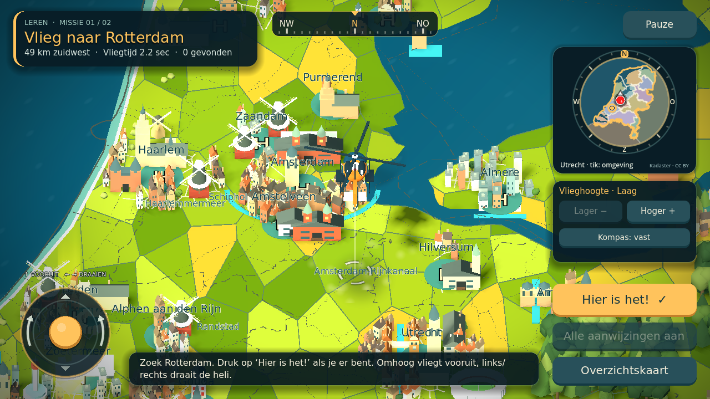

## Starten

Installeer **Godot 4.5.1 Standard** (geen .NET nodig), importeer `project.godot` en druk F5. Alle kaartdata, 3D-graphics, fonts en geluiden zijn meegeleverd. Er zijn geen online kaarttegels of game-accounts nodig.

- Kies Nederland of Europa en tik een van de drie spelmodus-kaarten aan (Leren, Oefenen of Records) en start een vliegmissie. In de hangar cirkelt je eigen helikopter boven de kaart, en Duitsland, België en Frankrijk lopen nu door tot aan de rand in plaats van te stoppen bij een grijze rechthoek.
- Sturen: joystick, WASD of pijltjes. Links/rechts draait de helikopter; omhoog/W vliegt vooruit en omlaag/S achteruit. De camera hangt achter de heli en draait soepel mee; achteruit gaat langzamer. Het kompas bovenin toont je koers. De overzichtskaart blijft noordgericht. De minikaart staat standaard ook noord boven; de heli is daarop een felrode stip met een witte punt die de neus aanwijst; met **Kompas: draait mee** (in de hangar, onder de vlieghoogtes of met toets **R**) draaien kompasrand en minikaart mee, zodat je neus altijd omhoog wijst. **Kompas: vast** houdt noord boven. De keuze wordt bewaard. N, O, Z en W staan op de rand van de minikaart en draaien mee. Menu en HUD schalen mee met brede telefoons en 4:3-tablets zonder scrollbalk. Antwoorden: ‘Hier is het!’ of spatie. M: overzicht.
- Je begint **laag en dichtbij**. Gebruik **Lager / Hoger**, het muiswiel of **Q / E** om tussen drie vlieghoogtes te wisselen. Lager toont meer detail; hoger geeft meer zicht op de omgeving. Elke hoogte ligt een stap hoger dan in eerdere versies: Laag is het oude Midden, Midden het oude Hoog, en Hoog laat een groot deel van het land zien. Gemeentegrenzen verschijnen bij Laag en Midden. De overzichtskaart (M) blijft apart beschikbaar. Het spel controleert je positie; er is geen landingssimulatie.
- **Doelzone:** zodra de modus het doel toont (Leren altijd, Oefenen als je dichtbij bent) zie je een gouden cirkel op de grond. Dat is precies het bereik waarin ‘Hier is het!’ goed telt; de minikaart toont dezelfde ring. Een lichtzuil en een zwevende markering wijzen het doel aan. Ben je binnen de cirkel, dan wordt alles groen, pulseert de antwoordknop en meldt de statusbalk ‘In de zone!’. Records toont nooit een zone. Landen worden op hun grens gecontroleerd en krijgen daarom wel de lichtzuil maar geen cirkel.
- **Grondvizier:** de camera kijkt schuin, waardoor de heli iets boven zijn echte positie lijkt te hangen. Een vizier op de grond met een loodlijn naar de heli toont het punt dat het spel controleert.
- **Effecten:** een goed antwoord geeft vuurwerk met fluitende pijlen, knallen en knetterende vonken, een schokgolf op de grond en een ‘GOED ZO!’-banner. Fout geeft een groot rood kruis met ‘MIS!’, een rood kruis op de grond, een rode flits, schudbeeld en een zoemer. Een voltooide missie eindigt met confetti, een fanfare en sterren die één voor één verschijnen. Verder: rotorstof bij laag vliegen, een bewegende rotorschijf, knipperende anti-botsingslichten en strobes, zachte glow en een vignet. Alle effectgeluiden worden bij het opstarten in code gesynthetiseerd; er zijn geen extra audiobestanden. ‘Geluid: uit’ dempt ook deze.
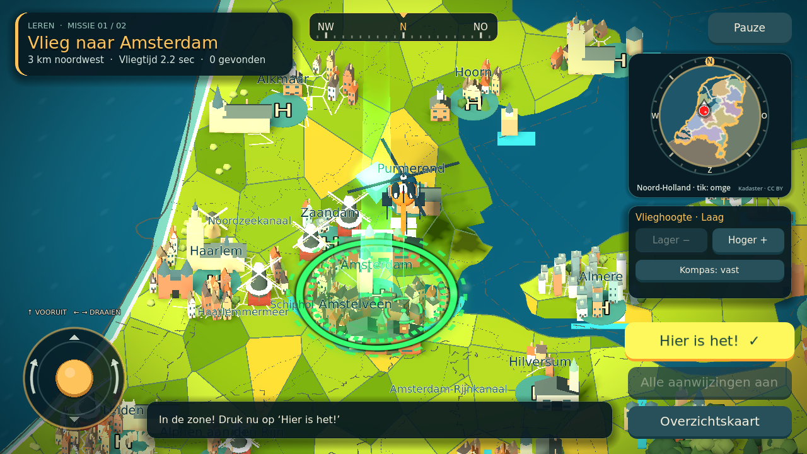

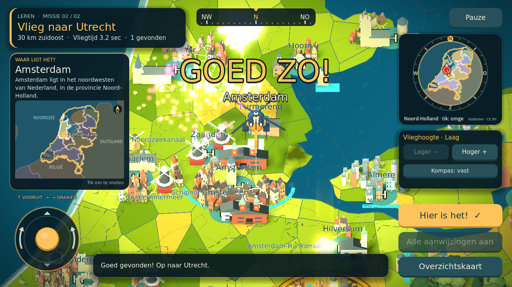

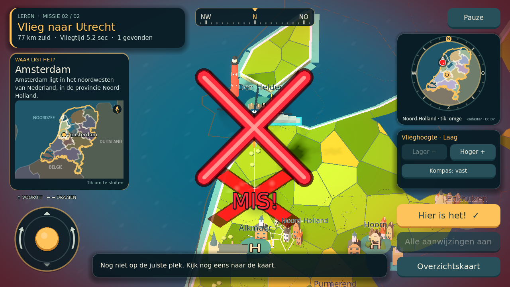

- **Waar ligt het?** Na een goed antwoord in Leren en Oefenen verschijnt zes seconden een kaartje van heel Nederland (of Europa) met de gevonden plek, de plekken die je eerder in de missie vond en een zin als ‘Assen ligt in het noordoosten van Nederland, in de provincie Drenthe.’ De provincie licht op. In Europa staat Nederland oranje als vast referentiepunt, bijvoorbeeld ‘Oslo ligt in Noorwegen, ten noorden van Nederland.’ Tik om het kaartje te sluiten. Records toont het niet.
- **Richting:** Leren toont afstand en windrichting (‘49 km zuidwest’). Oefenen toont geen plek, maar wel de windrichting (‘Richting: noordoost’) en een gouden pijl op de rand van de minikaart. Die pijl wijst in acht stappen (N, NO, O, …), dus een richting en geen exacte plek. Ben je dichtbij, dan verschijnt het doel zoals voorheen. Records geeft geen richting.
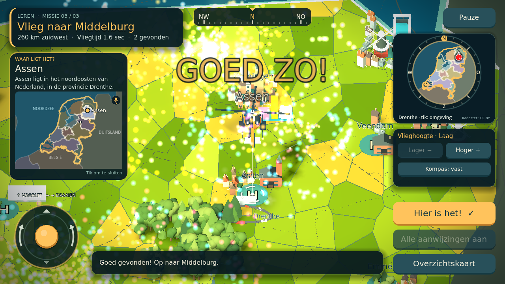

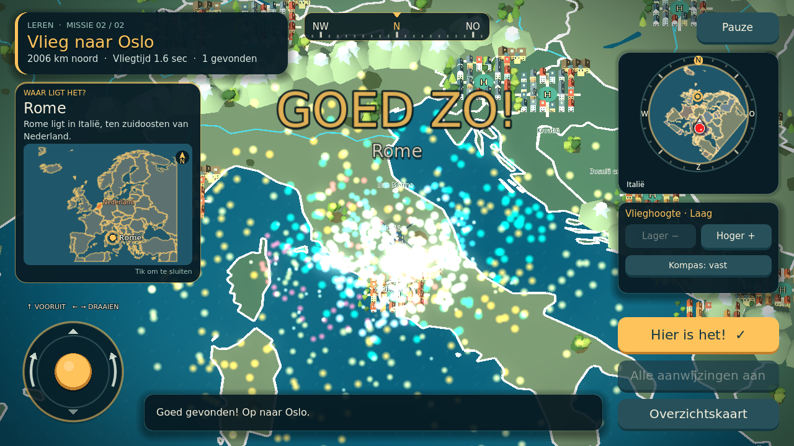

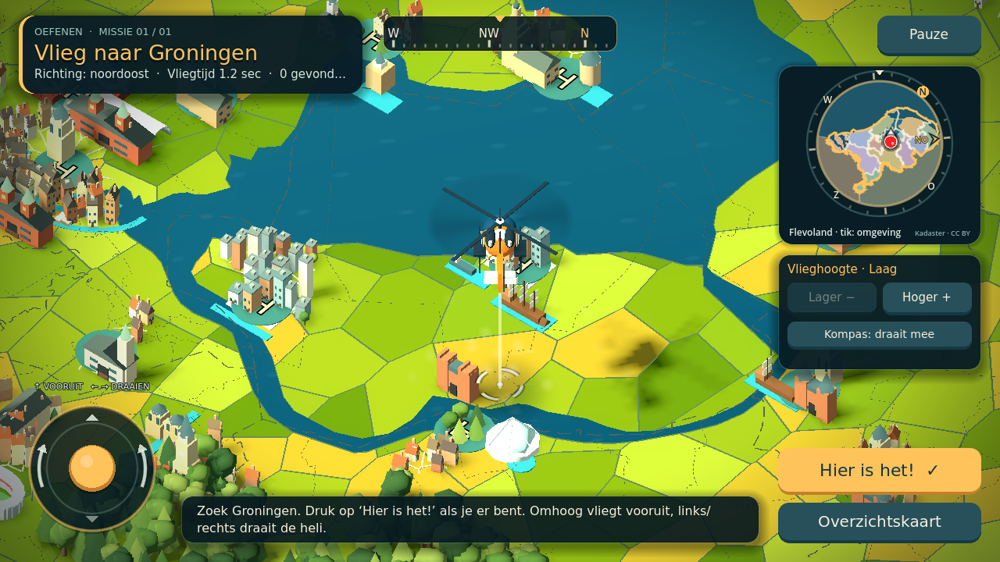

- ‘Pauze’, Escape of de Android-terugknop pauzeert de vlucht. Kies verder vliegen of stoppen naar de hangar. Naar de achtergrond schakelen pauzeert ook; hervatten doe je zelf. De terugknop sluit eerst een geopende foto.

## Nederlandse miniatuurwereld

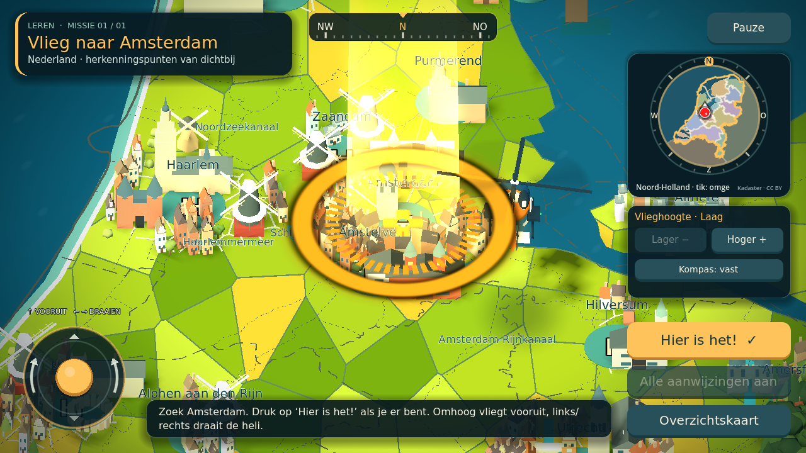

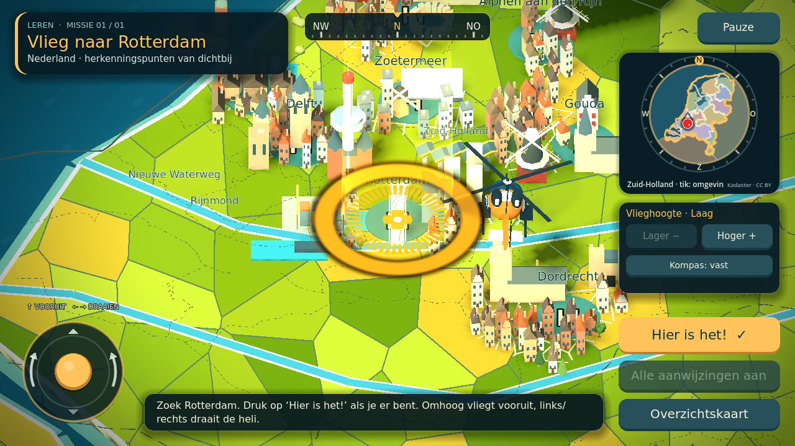

De referentiestijl is vertaald naar eenvoudige hoekige 3D-modellen, warm licht en water met subtiele beweging. De detailbeelden hierboven gebruiken een vaste opnamecamera; de gewone vlucht heeft de instelbare vlieghoogtes. Modellen worden per kleur samengevoegd, zodat elk raam of elke boom geen afzonderlijke tekenaanroep nodig heeft. Alle graphics blijven lokaal en werken offline.

Alle vijftig Nederlandse steden hebben nu een eigen wijkindeling, verschillende gevels, dakvormen, hoogtes en bebouwingsdichtheid. Historische centra, rivierstadjes, havens, groene woonsteden en moderne steden gebruiken verschillende typen bebouwing. Onder meer Arnhem/Nijmegen (verschillende boogbruggen), Leeuwarden (Oldehove), Groningen (Martinitorenmotief), Maastricht (Maasbrug en kerksilhouet), Den Haag (Hofvijver en hof) en Almere/Lelystad hebben een eigen centrum. De gebouwen, wegen en herkenningspunten blijven schematisch en uitvergroot; dit is geen nauwkeurig 3D-model van de echte stad. De beschikbare globale Natural Earth-bebouwde contouren begrenzen de gegenereerde woonwijken. Voor Sneek ontbreekt dekking en wordt een schematische indeling gebruikt.

### Echte herkenningspunten

Elke Nederlandse stad heeft 1 tot 3 echte herkenningspunten, samen 102 stuks, in [`data/landmarks_nl.json`](data/landmarks_nl.json). Voorbeelden zijn het Centraal Station en het Rijksmuseum in Amsterdam, de Euromast en de Kubuswoningen in Rotterdam en de Sint-Bavo, Molen De Adriaan en de Amsterdamse Poort in Haarlem. Ook het Stadhuis en Molen De Roode Leeuw in Gouda, het Evoluon en het Philips Stadion in Eindhoven, de Lange Jaap in Den Helder, de schachtbok en het Glaspaleis in Heerlen en de hunebedden bij Emmen staan erin. Ze worden gebouwd uit een vaste set silhouetten in `scripts/landmark_kit.gd`: kerk, molen, poort, kasteel, stadion, vuurtoren, schip en meer. De woningen op die plek maken plaats. De posities volgen grofweg de echte ligging in de stad; maat en detail zijn uitvergroot. Namen staan alleen in het databestand en worden in het spel niet getoond, zodat Oefenen en Records geen doel verraden.

### Spuitcabine

Via **Helikopter spuiten** in de hangar kies je een van negen kleurschema's, zoals Politie, Traumageel of Nachtzwart. Met drie kleurkiezers stel je ook zelf de romp, strepen en rotor in. Een draaiend 3D-voorbeeld toont het resultaat direct. De keuze wordt opgeslagen in je voortgang; ongeldige kleuren vallen terug op de fabriekskleuren.

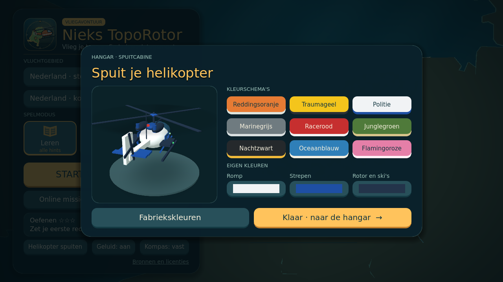

### Grenzen op landschap en minikaart

- Op het landschap: neutrale lijnen, met een dikke landsgrens, gestreepte provinciegrenzen en fijnere gestippelde gemeentegrenzen. Gemeentegrenzen verschijnen bij laag/midden vliegen; op grote afstand blijft de kaart rustig. Gebieden op het landschap krijgen **geen provincie- of gemeentekleuren**.
- De minikaart is rond, met een kompasrand (N, O, Z, W en een streepje per 15°). Alleen de minikaart kleurt de twaalf provincies in. De landsgrens is goud, provinciegrenzen zijn licht en gemeentegrenzen blauwgrijs (alleen in de omgevingsweergave). Buurlanden staan er in hun geheel op, in gedempte kleuren: de Nederlandse kaartdata stopt bij 7,5°O en 50,5°N, dus voor België, Duitsland en Frankrijk gebruiken de minikaart en het Waar-ligt-het-kaartje de Europese contouren. Het 3D-landschap verandert daardoor niet.
- **Tik of klik op de minikaart** om te wisselen tussen Nederland en de omgeving. De lokale weergave volgt de helikopter en maakt gemeentegrenzen beter leesbaar. Onderaan staat de huidige provincie (boven Europa het land). In Records staat daar alleen ‘Nederland’ of ‘Europa’, zodat de minikaart geen antwoord verraadt.
- De gebundelde Nederlandse grensdata omvat twaalf provincies en 342 gemeenten uit de officiële Kadaster/PDOK-laag van 2026. De lijnen zijn vereenvoudigd voor de game. Bronvermelding en licentie zijn ook bereikbaar via **Bronnen en licenties** in de hangar.

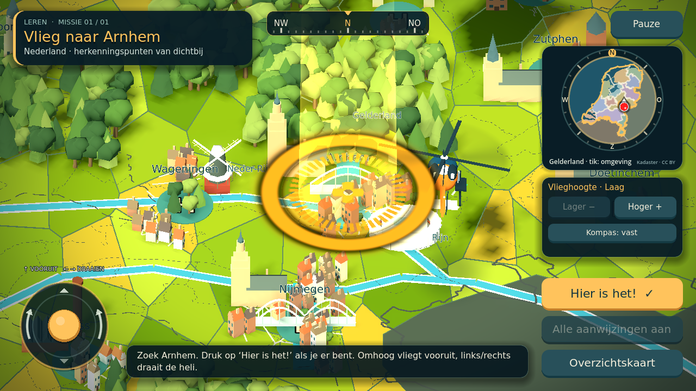

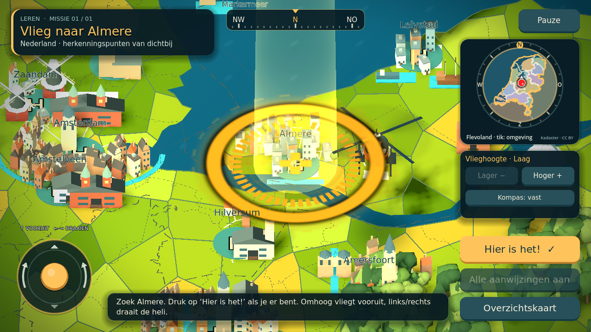

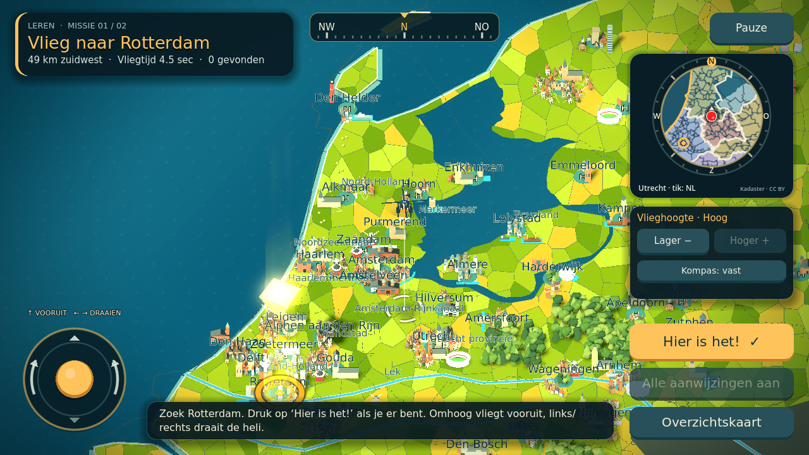

De decoratieve akkers kunnen worden herbouwd met `uv run --with shapely python tools/build_nl_fields.py`. Shapely is alleen nodig voor dit ontwikkelhulpmiddel, niet voor het spel.

## Schoolwerk

Open **Foto / eigen topo-opdrachten**. Kies een JPG of PNG van maximaal 25 MB en 24 megapixel. Een foto blijft lokaal als referentie; voer de gewenste namen in of gebruik de optionele OCR-service. Voor een eigen locatie:

```
Arnhem
IJsselmeer
Mijn dorp | 52.123 | 5.456
```

Een eigen punt is `naam | breedtegraad | lengtegraad` in WGS84-graden, eerst de breedtegraad (noord), dan de lengtegraad (oost; west is negatief). Een decimale punt of komma mag (`52.123` of `52,123`). Punten buiten de Europakaart (34°–72°N, 25°W–45°O) worden geweigerd. Op regels zonder `|` mogen namen ook met komma's worden gescheiden. De app meldt onbekende namen en dubbelzinnige dubbele namen. Europese en Nederlandse plaatsen mogen worden gemengd. Gebruik `Utrecht provincie` / `Groningen provincie` voor provincies, en `Luxemburg land` voor het land.

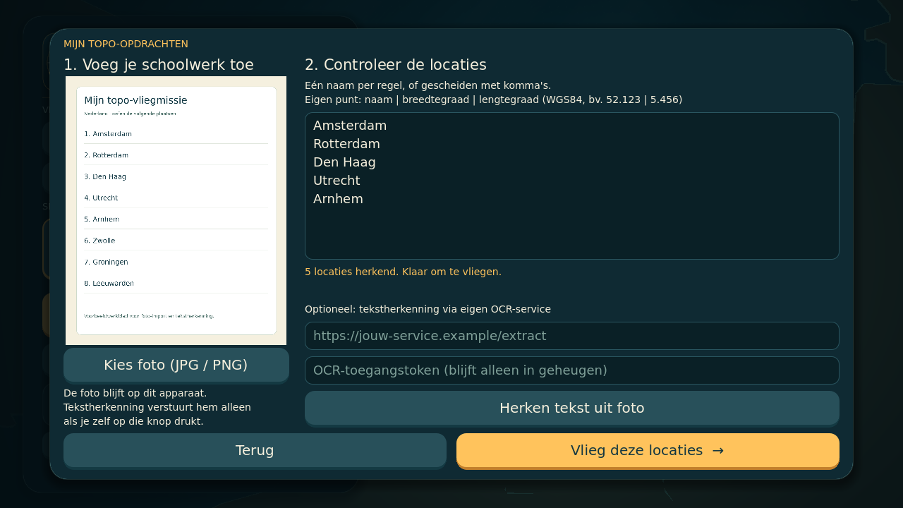

OCR is **optioneel en niet standaard gehost**. De eigen service en Dockerfile staan in `ocr-service/`. Deze gebruikt HTTPS en een gedeeld toegangstoken. Het token blijft alleen in appgeheugen. Alleen een druk op ‘Herken tekst uit foto’ verstuurt de afbeelding. De service gebruikt Tesseract via stdin/stdout, zonder tijdelijk werkbladbestand. Zie [OCR-installatie](ocr-service/README.md).

De ouder controleert altijd de herkende locaties. Een kopje zoals ‘Nederland’ kan ten onrechte als opdracht worden toegevoegd. OCR leest tekst; onbenoemde kaarten met alleen nummers of kruisjes worden niet automatisch opgelost.

## Geografie en leren

- Landvragen controleren het landpolygoon op de kaart. Volgens de Nederlandse schooltopografie telt de Krim als Oekraïne, Noord-Cyprus als Cyprus en Åland als Finland.
- Andere vragen controleren een referentiepunt met tolerantie per locatie. Een stad telt als gevonden boven de hele zichtbare stad: Nederlandse steden op de Nederlandkaart krijgen de straal van hun stadsplan plus 0,8 km, minimaal 6 km (bijvoorbeeld Utrecht 9,2 km, Den Haag 6 km). In Europa-missies houden Nederlandse steden 6 km. Europese steden krijgen 45 km, genoeg voor hun modelstad en nog los van de dichtstbijzijnde hoofdsteden (Wenen en Bratislava liggen 55 km uit elkaar). Eigen punten 6 km (Nederland) of 25 km (Europa), Nederlandse eilanden 10 km, Europese eilanden 25 km, provincies 25 km, Nederlandse wateren 25 km en Europese wateren 40 km. Europese zeeën, rivieren, meren, gebergten en eilanden hebben elk een eigen `radius_km` (bijvoorbeeld Middellandse Zee 380 km, Alpen 220 km, Rijn 55 km). Een positief, eindig `radius_km` kan dit overschrijven. Provincies, rivieren, eilanden en meren hebben **geen volledige gebieds-/rivierdetectie**. De getekende provinciegrens verandert deze antwoordcontrole niet.
- Natural Earth-contouren zijn grof, vooral rond delta's en kleine eilanden. Europa loopt circa 25°W–45°O en 34°–72°N.
- Velden, bomen, gebouwen en bergen zijn gestileerde decoratie; geen echte hoogte- of landgebruiksdatabase.
- Drie sterren: een foutloze Records-vlucht; twee als minstens 80% van de locaties in één keer goed is; anders één. De samenvatting toont welke locaties nog oefening vragen. Eigen missies overschrijven de presetsterren niet. Records bewaart daarnaast de beste tijd per route. Er is nog geen adaptief herhalen of langdurige voortgang per locatie.
- Nederland heeft een kleurrijke miniatuurwereld met grachtenpanden in Amsterdam, de Domtoren, een Rotterdamse haven met vereenvoudigde Erasmusbrug, duinen en gemengd bos. Steden staan op hun cataloguscoördinaten; gebouwen en landschapselementen zijn uitvergroot en symbolisch. Dit is geen nauwkeurige stratenkaart. Europa heeft nu eigen stadswijken, regionale bouwstijlen, herkenningspunten, bossen en berggordels; zie [Europa](docs/EUROPA.md).
- Het IJsselmeer/Markermeer is opnieuw uitgesneden met gedetailleerdere meergeometrie; Flevoland, Almere en Lelystad blijven op land.
- Vliegen in Nederland is rustiger gemaakt zodat je tijd hebt om te zoeken. Kindertests en prestaties op echte Android-toestellen blijven nodig.

De meest recente foto, eigen missielijst en beste sterren per regio/modus blijven op het apparaat. Wis appgegevens om die te verwijderen. Ook het verwijderen van de app wist deze gegevens; zie ‘Android bouwen’ voor veilig updaten. Het OCR-token wordt niet opgeslagen.

## Review en controles

De [review van 7 november 2026](docs/REVIEW.md) beschrijft de gevonden fouten, correcties, testresultaten en openstaande punten. In versie 0.2 zijn onder andere touch-emulatie, OCR-toegang, concurrency, beeldlimieten, opslagvalidatie, testisolatie, kaartmarkers en minikaartverversing aangepast.

```
python3 -m venv .venv
.venv/bin/pip install -r ocr-service/requirements.lock.txt -r tests/requirements.txt
.venv/bin/python -m unittest discover -s tests -v
GODOT_BIN=/pad/naar/godot python3 tools/check_godot.py
.venv/bin/pip-audit -r ocr-service/requirements.lock.txt
```

Installeer Tesseract met Nederlandse en Engelse taaldata voor lokale OCR-tests:

```sh
# macOS (Homebrew)
brew install tesseract tesseract-lang
# Ubuntu / Debian
sudo apt-get install tesseract-ocr tesseract-ocr-nld tesseract-ocr-eng
# Controleer dat nld en eng beschikbaar zijn
tesseract --list-langs
```

De Docker-image en GitHub Actions installeren deze taaldata al. Met Tesseract (`nld` en `eng`) geïnstalleerd draait ook de echte OCR-test:

```
TOPOROTOR_TEST_REAL_OCR=1 .venv/bin/python -m unittest discover -s tests -v
```

GitHub Actions bevat dezelfde backend- en enginechecks, met alleen leesrechten. De nieuwste uitslagen staan onder Actions in GitHub. Een lokale testuitslag is geen uitgevoerde GitHub Actions-run.

## Android bouwen

Het project bevat een Android-exportpreset voor ARM64 met de Compatibility-renderer. Installeer Godot 4.5.1 exporttemplates, OpenJDK 17 en de Android SDK volgens de [Godot-handleiding](https://docs.godotengine.org/en/4.5/tutorials/export/exporting_for_android.html). Stel de SDK-paden en een eigen debugkeystore in via **Editor Settings → Export → Android**. Exporteer preset **Android** met ‘Export With Debug’ naar `build/TopoRotor-debug.apk`.

De repository bevat geen signing key, tokens of APK's. Android installeert een update alleen over de bestaande app als beide met dezelfde sleutel zijn ondertekend. Gebruik daarom voor alle builds die je verspreidt één vaste keystore. Bewaar die buiten de repository, maak er een back-up van en deel hem niet via git. Alleen dan blijven missielijsten en sterren bij updates en rollbacks behouden.

**Let op:** een build met een andere handtekening (bijvoorbeeld een debugbuild van een andere computer) kan niet over de oude app heen worden geïnstalleerd. De oude app verwijderen wist alle lokaal bewaarde foto's, eigen missielijsten en sterren. Er is nog geen export of synchronisatie. Kopieer vóór het verwijderen de tekst van je eigen missielijst, zodat je die daarna opnieuw kunt invoeren. Behaalde sterren gaan in dat geval verloren. Voor native foto-selectie is Android 10+ bedoeld. Touch, Android-fotopicker, lifecycle, geheugen en prestaties moeten nog op echte telefoons/tablets worden getest.

## Indeling

| Map / bestand | Doel |
|---|---|
| `scripts/main.gd` | Menu, missies, foto-import en OCR-client |
| `scripts/world.gd` | Kaartmeshes, decoratie, markers en landcontrole |
| `scripts/helicopter.gd` | Helikopter en rotoranimatie |
| `scripts/dutch_scenery.gd` | Gebundelde miniatuurgebouwen, Nederlandse herkenningspunten, bomen en reliëf |
| `scripts/worksheet_image.gd` | Beeldheader- en dimensiecontrole vóór pixelallocatie |
| `scripts/progress_store.gd` | Validatie van opgeslagen voortgang |
| `assets/` | Modellen, graphics, fonts en geluiden |
| `data/` | Kaartgeometrie en locatiecatalogus |
| `ocr-service/` | Optionele service, lockfile en Dockerfile |
| `tests/`, `tools/` | API-tests, integratietest en geïsoleerde enginechecks |
| `.github/workflows/ci.yml` | CI voor tests en dependency-audit |

Eigen code en graphics: MIT. Zie [LICENSE](LICENSE), [THIRD-PARTY.md](THIRD-PARTY.md) en de font- en enginelicenties in `assets/`.

## Sneller vliegen en drie spelmodi

Nederland vliegt met 10 wereldeenheden per seconde, Europa met 42.
Besturing en bochten reageren vloeiend; loslaten remt sneller af.

- **Leren:** doelmarker op de wereld en minimap, kaartnamen en afstand zichtbaar.
- **Oefenen:** geen doelmarker of afstand op grote afstand. Het doel verschijnt
  pas binnen 18 km in Nederland of 75 km in Europa, en verdwijnt weer buiten
  die afstand. Bij landvragen verschijnt het doel zodra je boven het juiste
  land vliegt. Kaartnamen blijven verborgen.
- **Records:** geen doelmarker, kaartnamen of afstandshints. Een stopwatch meet
  je tijd; elk fout antwoord telt als 10 seconden straftijd. Beste tijden worden
  lokaal per route bewaard. Dezelfde route heeft een vaste volgorde voor eerlijke
  herhalingen; andere missies hebben hun eigen record. Er is geen tijdslimiet.

De H-toets kan de regels van Oefenen en Records niet omzeilen.
De stopwatch pauzeert als de app naar de achtergrond gaat.

Met **Online missies** kun je lespakketten laden en offline bewaren zonder een
nieuwe APK. Zie [online missies](docs/ONLINE-MISSIES.md) voor het JSON-formaat.
Zie [APK-builds](docs/ANDROID-BUILDS.md) voor de automatische Android-build,
vaste signing key en downloaden via GitHub Releases.

## Europese routes en nieuwe graphics

Europa biedt een kort rondje, **43 hoofdsteden** en **50 landen**. Alle routes
werken met Leren, Oefenen en Records. Meer variatie door zuidelijke, noordelijke
en continentale stadswijken, eigen herkenningspunten, bossen en besneeuwde
bergketens. De helikopter heeft een stoerdere reddingsuitvoering en Europa
heeft bewegend water en licht op het landschap.

Zie [Europese wereld en data](docs/EUROPA.md) voor de kaartuitsnede, decoratie,
brondata en de punttolerantie voor Vaticaanstad.
