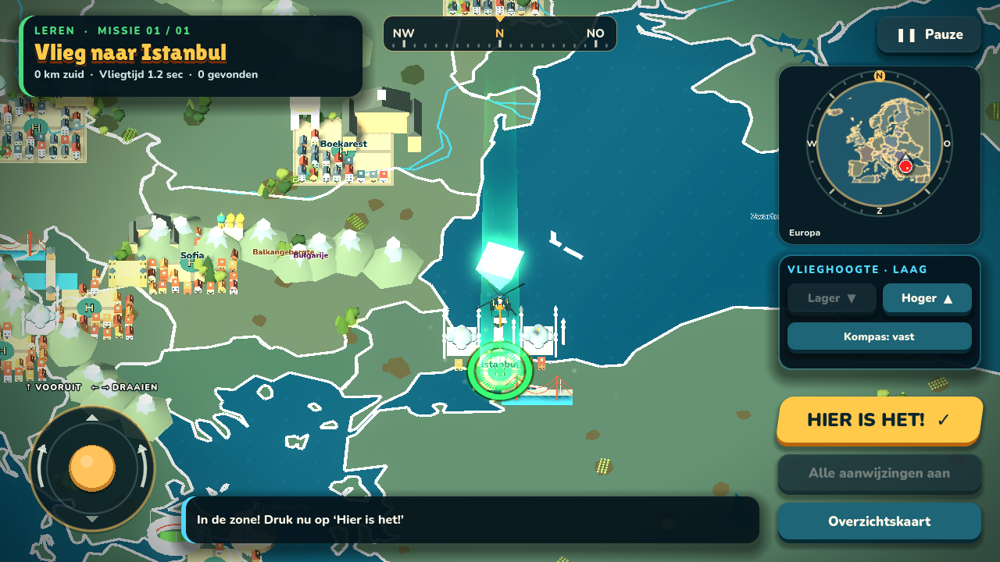
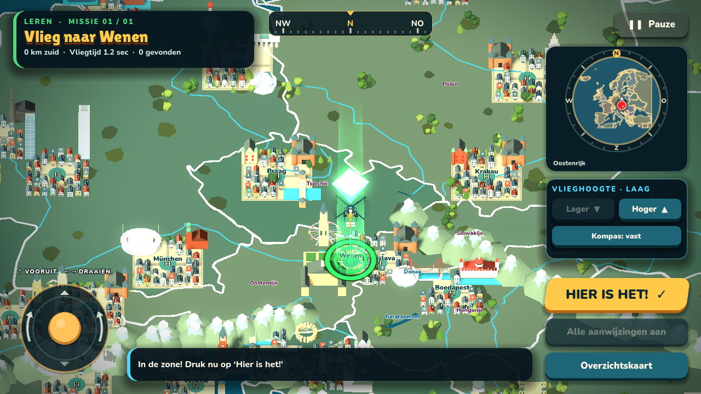
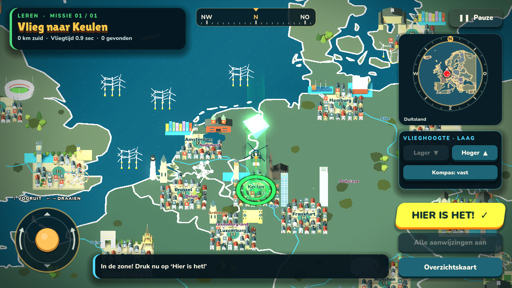
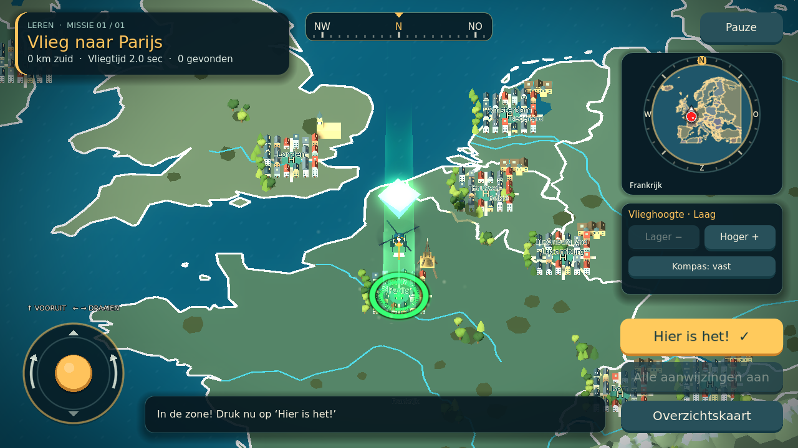
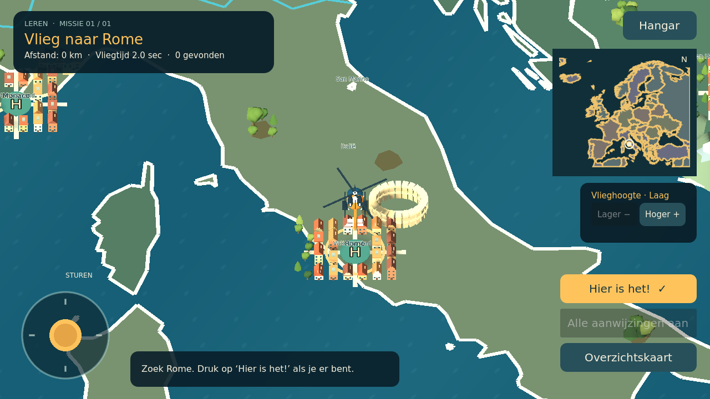
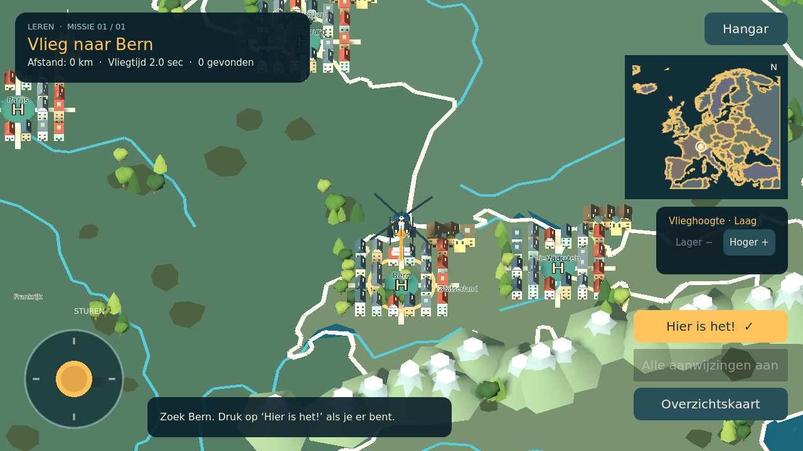

# Europa: routes en miniatuurwereld

Kies Europa en vervolgens een van de twaalf routes (`data/routes_eu.json`):
een kort rondje, de 43 hoofdsteden, de 50 landen (inclusief de opgenomen
transcontinentale landen en Kosovo), zeeën en oceaan, rivieren en meren,
gebergten en eilanden, grote steden, West-, Noord-, Midden- en Zuid-Europa en
de Leerkaart Europa met een mix van alles.
Leren, Oefenen en Records gelden voor elke route, ook online en eigen missies.
Het record geldt steeds voor precies de gekozen route.

- Leren toont kaartnamen, afstand en doelmarkers.
- Oefenen verbergt de markers tot binnen 75 km bij steden; bij landen tot je
  boven het land vliegt. H en overzicht onthullen geen verborgen kaartnamen.
- Records verbergt markers, namen en afstand en telt 10 seconden straf per fout.

## Topografie (0.5)

Europa is net zo uitgebreid als Nederland. Naast landen en hoofdsteden bevat
de catalogus nu 13 zeeën en de oceaan, 14 rivieren, 6 meren, 11 gebergten en
landstreken, 4 schiereilanden/regio's, 6 eilanden en 20 grote steden (onder
meer Barcelona, Milaan, München, Istanbul, Napels en Sint-Petersburg). Elke
plek heeft een eigen antwoordstraal (`radius_km`) rond een kenmerkend punt;
dat is geen echte gebieds- of rivierdetectie. De Noordzee en de Rijn staan
per regio in de catalogus: op de Nederlandkaart geldt het Nederlandse punt,
in Europa het Europese. Kaartnamen krijgen atlaskleuren: water blauw,
gebergten bruin, eilanden groen, landen paars.

## Graphics

Elke hoofdstad en grote stad heeft 1 tot 3 echte herkenningspunten uit
`data/landmarks_eu.json` (136 in totaal): onder meer de Eiffeltoren en
Arc de Triomphe, Big Ben, Tower Bridge en de London Eye, het Atomium, de
Sagrada Família, de Blauwe Moskee en de Bosporusbrug, het Kremlin, het
Colosseum, de Dom van Keulen, het Boedapester parlement, de Vesuvius en de
Hallgrímskirkja. Europa-eigen silhouetten staan in `scripts/europe_scenery.gd`;
de Nederlandse landmark-kit wordt in Europa op 1,8× schaal hergebruikt.
Naburige steden (Wenen en Bratislava, Tallinn en Helsinki) delen de grond
tussen hun ankers, zodat wijken en herkenningspunten niet in elkaar schuiven;
huizen boven zee worden overgeslagen.

Het landschap kreeg extra berggordels (Apennijnen, Dinarische Alpen,
Kaukasus, Schotse Hooglanden, Balkangebergte), een taiga-gordel in het
noorden, olijfgaarden en wijngaarden in het zuiden, schepen op de zeeën,
vuurtorens op kapen en windparken in de Noordzee en de Oostzee. Landchecks
gebruiken nu per landpolygoon een bounding box; de Europese wereld bouwt
daardoor sneller ondanks de extra inhoud (lokaal gemeten: 534 → 322 ms).

### Eerdere basis

Alle 43 opgenomen hoofdsteden krijgen een wijk met huizen, straten, bomen en
centraal helikopterplatform. De stijlen verschillen tussen zuidelijke,
noordelijke en continentale steden. Parijs, Londen, Berlijn, Rome en Athene
hebben eigen vereenvoudigde herkenningspunten; andere steden krijgen onder
meer koepels, paleizen, vestingen en noordelijke raadhuizen.

Het landschap heeft gestileerde berggordels, sneeuwkappen, rotsen, bosgroepen
en onregelmatige kleurvlakken. Water beweegt en het land ontvangt licht en
schaduw. De helikopter heeft een oranje/antraciete reddingsuitvoering met
turbines, versterkte neus, zijsteunen en contrasterende markeringen.
De Europese vlieghoogte is verhoogd om over de nieuwe miniaturen te vliegen.

Geometrie wordt per kleur samengevoegd; geen nieuwe externe textures,
downloads, plug-ins of online kaarttegels. Echte tabletprestaties moeten nog
worden gecontroleerd. Het terrein is decoratie, geen hoogte-/landgebruikdata;
gebouwen zijn uitvergroot en liggen rond catalogusankers, niet op echte straten.
De kaart blijft beperkt tot 25°W–45°O en 34°–72°N; Rusland en andere landen die
daarbuiten doorlopen worden alleen binnen die uitsnede getoond.

## Data

De 17 extra landvragen gebruiken bestaande Natural Earth-landpolygonen uit
`map_eu.json`. Referentiepunten komen uit bestaande hoofdstadankers of het
gemiddelde van de kaartpolygoon. Landantwoorden gebruiken de hele polygoon.
Vaticaanstad heeft in de bestaande kaart geen polygoon: het gebruikt het
referentiepunt 41.904 N, 12.453 E en een 1,5 km-punttolerantie (hulp verschijnt binnen 5 km). Dit is
voor microstaten nadrukkelijk geen nauwkeurige grensdetectie.
Vaticaanstad-anker: https://www.wikidata.org/wiki/Q237 (CC0).

De bestaande Nederlandse schooltopografie-toewijzingen voor Krim,
Noord-Cyprus en Åland blijven gelden. Namen en catalogusuitbreidingen worden
ook door de OCR-service gelezen; deze moet tegelijk opnieuw worden uitgerold
als je de optionele OCR gebruikt.

## Voorbeelden

